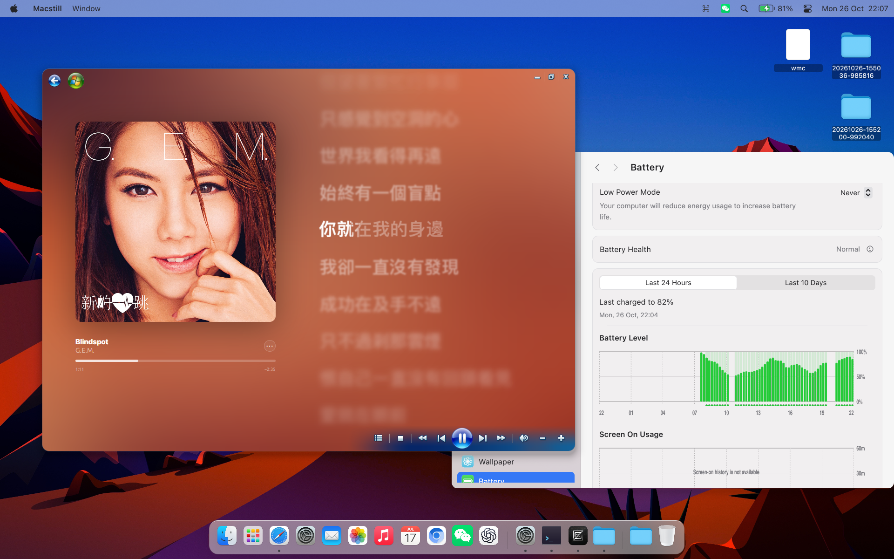

# Macstill

[English](README.md) · [简体中文](README.zh-CN.md) · [Deutsch](README.de.md) · [日本語](README.ja.md)

Macstill 是基于 **Rust、GPUI 和 Hyprland** 构建的 Linux 桌面环境，提供受 macOS 启发的视觉与交互体验，整合桌面 Shell、Finder 文件管理器、系统设置、系统信息、截图工具和 AirDrop。

## 界面预览

### 桌面概览


### 动态演示


## 功能

- **启动台（Launchpad）**：应用启动与管理界面。
- **Finder**：集成文件搜索的文件管理器。
- **台前调度（Stage Manager）**：窗口分组与切换。
- **调度中心（Mission Control）**：工作区与窗口概览。
- **程序坞（Dock）**：应用固定与运行状态指示。
- **自定义应用图标**：替换图标、隐藏不使用的预设图标。
- **系统信息**：硬件与系统状态面板，部分实现。
- **系统设置**：界面、图标与交互仍在完善中。
- **截图工具**：部分实现，存在已知问题。
- **音乐**：受 Windows Media Center 启发。
- **密码管理器**：目前仅有 UI。
- **AirDrop**：基于 [owly](https://github.com/t4t5/owly) 集成。

项目正在积极开发中，部分组件尚未完成。

## 项目结构

| 目录 | 内容 |
| --- | --- |
| `apps/` | 桌面应用与入口 |
| `crates/` | 共享组件与系统服务 |
| `plugins/` | Hyprland 全局菜单和台前调度集成 |
| `assets/` | 图标、图片等静态资源 |
| `config/` | 桌面与 Hyprland 默认配置 |
| `packaging/` | 桌面入口与服务模板 |
| `vendor/` | 修改后的第三方源码 |

## 开发

目标平台为运行 Hyprland 的 Linux，使用 Rust 2024 edition。构建需要兼容的 Rust 工具链及 GPUI 和系统集成所需的原生库。

```sh
cargo build --workspace --locked
cargo run -p finder
cargo run -p macstill-info -- --about
```

组件详情见 [Finder 文档](apps/finder/README.md)和[系统信息文档](apps/info/README.md)。Hyprland 配置示例位于 `config/`，打包模板位于 `packaging/`。

## 参与贡献

欢迎提交 Issue 和 Pull Request。报告问题时请提供复现步骤及相关环境信息。

## 致谢与许可

感谢开源社区，特别是 GPUI、Hyprland 和 [owly](https://github.com/t4t5/owly)。

Macstill 源代码使用 [MIT 许可证](LICENSE)。第三方代码和美术资源保留各自的许可；源代码许可证不重新授权参考美术资源。
